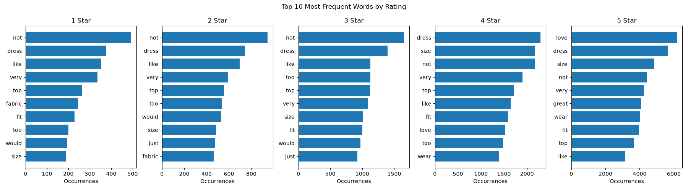

# nlp-02-text-preprocessing-custom

## Project Overview

- **Author:** Alex Heyert
- **Project:** Web Mining and Applied NLP, Project 02
- **Date:** November 2026

This project examines how text-preprocessing decisions affect the vocabulary
and token counts in clothing reviews. The analysis uses review text and its
1 to 5 star rating to compare token frequencies across rating groups.

The analysis is in the
[text preprocessing notebook](notebooks/text_preprocessing.ipynb). The detailed
report, including methods, results, figures, observations, and limitations, is
in [docs/index.md](docs/index.md).

## Data

The project uses the [Women's E-Commerce Clothing Reviews dataset on
Kaggle](https://www.kaggle.com/datasets/nicapotato/womens-ecommerce-clothing-reviews),
included locally as [`data/clothing_reviews.csv`](data/clothing_reviews.csv).
Each record is a customer review with its rating and other product metadata.
The notebook selects the `Review Text` and `Rating` columns and excludes rows
with missing values in those columns.

## Methods and Custom Changes

The notebook uses Polars to read and process the data, Matplotlib to create
visualizations, and NLTK's Porter stemmer to compare word forms. Processing
includes whitespace tokenization, removing non-letter characters, lowercasing,
filtering stopwords and tokens shorter than three characters, and stemming.


## Results and Visuals

In the latest saved notebook results, the analysis starts with 1,362,913 raw
tokens and 38,473 unique tokens. After stopword and short-token filtering,
750,927 tokens remain. After stemming, the unique-token count is 13,757.

The most frequent words in the rating 5 group include `love` (6,186),
`dress` (5,656), and `size` (4,844). See the report for the full results,
rating-group counts, and your observations and interpretation.

**Token counts and unique vocabulary by preprocessing stage**


**Frequently occurring words across rating groups**


**Top words for each rating**


## Run the Analysis

1. Follow the environment setup steps below.
2. Open [`notebooks/text_preprocessing.ipynb`](notebooks/text_preprocessing.ipynb)
   in VS Code.
3. Select the Python environment created for this project and run all notebook
   cells.


## Developer Reference

Follow the [Professional Python Workflow Guide](https://denisecase.github.io/pro-analytics-02/) for detailed instructions and troubleshooting.

### Initialize and Update the Python Environment

```shell
uvx pup-clean --delete
uv self update
uv python pin 3.14
uv python install
uv lock --upgrade
uv sync
uv add nltk
uv audit
```

### Set Up and Run Git Hooks

```shell
uvx prek install --force
uvx prek update --freeze --cooldown-days 7

git add -A
uvx prek run --all-files
# Repeat if changes were made.
uvx prek run --all-files
```

### Run Common Checks

```shell
uv run ruff check . --fix
uv run ruff format .
uv run ty check
uv run python -m pytest
uv run python -m zensical build
```

### Git Add, Commit, and Push

```shell
git add -A
git commit -m "describe your changes in quotes"
git push -u origin main
```

## Project Links

- [GitHub repository](https://github.com/ajaneh/nlp-02-text-preprocessing-custom)
- [Published project documentation](https://ajaneh.github.io/nlp-02-text-preprocessing-custom/)
- [Project report](docs/index.md)
- [Analysis notebook](notebooks/text_preprocessing.ipynb)
- [Data source on Kaggle](https://www.kaggle.com/datasets/nicapotato/womens-ecommerce-clothing-reviews)
- [Adapted example project](https://github.com/denisecase/nlp-02-text-preprocessing)
- [Professional Python Guide](https://denisecase.github.io/pro-analytics-02/)
