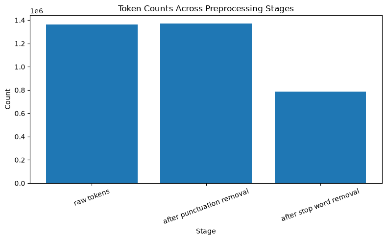
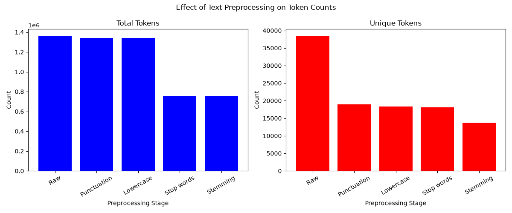
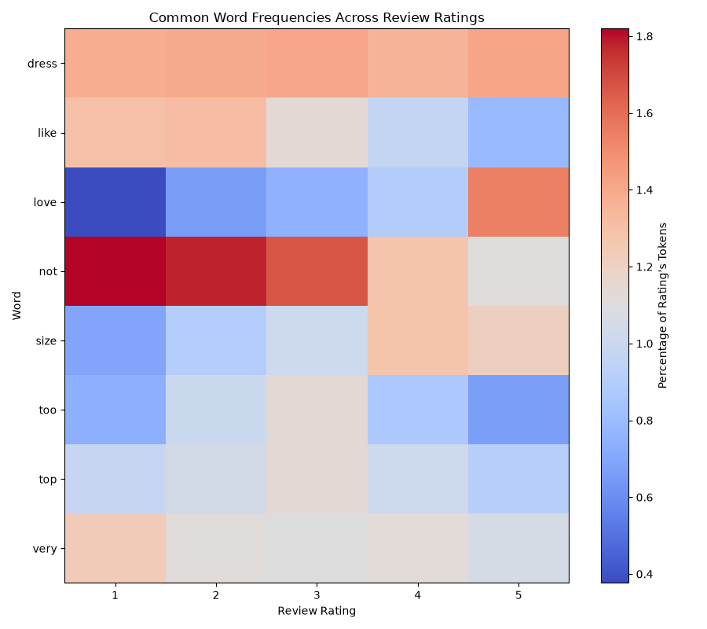

# nlp-02-text-preprocessing-custom

## Project Overview

- **Author:** Alex Heyert
- **Date:** 2026 November

A dataset of reviews (1-5) and corresponding review text was obtained from [Kaggle](https://www.kaggle.com/datasets/nicapotato/womens-ecommerce-clothing-reviews)

The first change was to read the new datafile into a polars dataframe
This project focuses on how preprocessing steps affect the tokens. Rather than using python I used polars at each step of processing, I also removed numbers in addition to punctuation, preserving the content of contractions but enforcing a pattern of only allowing alphabetical characters.
This prokect tokenizes the review text to see if there are word patterns attributed with higher or lower ratings.


## Project Commands

Follow the developers reference to create the environment.
Then go to the [Notebook](notebooks/text_preprocessing.ipynb) select the enviroment python kernel and "Run All"

## Visual Evidence

**Token Counts with previous pipeline**


**Token Counts with revised pipeline**


**Heatmap of Words and Ratings**


## Developer Reference

Follow the [Professional Python Workflow Guide](https://denisecase.github.io/pro-analytics-02/) for detailed instructions and troubleshooting.

### Initialize and Update the Python Environment

```shell
uvx pup-clean --delete
uv self update
uv python pin 3.14
uv python install
uv lock --upgrade
uv sync
uv audit
```

### Set Up and Run Git Hooks

```shell
uvx prek install --force
uvx prek update --freeze --cooldown-days 7

git add -A
uvx prek run --all-files
# Repeat if changes were made.
uvx prek run --all-files
```

### Run Common Chores

```shell
uv run ruff check . --fix
uv run ruff format .

uv run ty check
uv run python -m pytest
uv run python -m zensical build
```

### Git add-commit-push to GitHub

```shell
git add -A
git commit -m "describe your changes in quotes"
git push -u origin main
```

## Developer Tools

TODO — confirm which tools this project uses after customizing the code and project. Possible Python tools include:

- [uv](https://docs.astral.sh/uv/) — Python environments and dependencies.
- [Ruff](https://docs.astral.sh/ruff/) — Python linting and formatting.
- [ty](https://docs.astral.sh/ty/) — Python type checking.
- [pytest](https://docs.pytest.org/) — automated testing.
- [prek](https://prek.j178.dev/) — Git hooks and automated checks.
- [Zensical](https://zensical.org/) — project documentation.

## Links

- [GitHub repository](https://github.com/ajaneh/nlp-02-text-preprocessing-custom)
- Project documentation: [Github Pages](https://ajaneh.github.io/nlp-02-text-preprocessing-custom/)
- Adapted example project: [NLP 02 Text Preprocessing](https://github.com/denisecase/nlp-02-text-preprocessing).
- Data source: [Kaggle](https://www.kaggle.com/datasets/nicapotato/womens-ecommerce-clothing-reviews)
