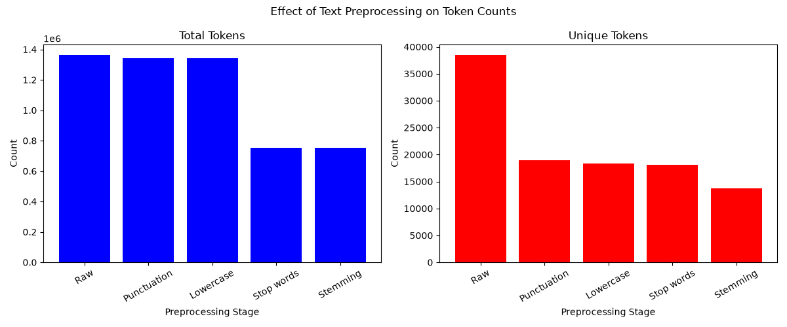
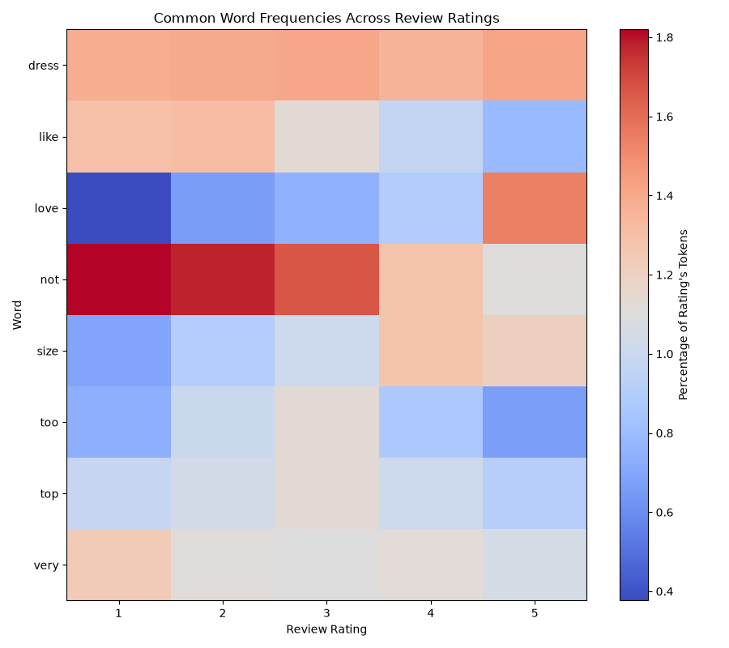
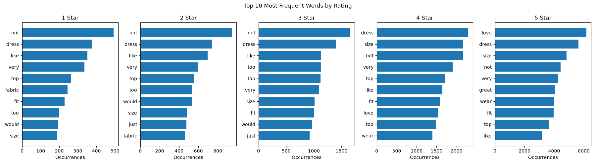

# Web Mining and Applied NLP: Text Preprocessing

## Opening

**Alex Heyert | Project 02 | November 2026**

This project examines how text-preprocessing choices change the tokens and
vocabulary found in product reviews. The analysis asks how punctuation and
number removal, lowercasing, stopword filtering, and stemming affect review
text, and how frequently occurring words vary across 1-to-5-star ratings.

## Data

The analysis uses the [Women's E-Commerce Clothing Reviews dataset on
Kaggle](https://www.kaggle.com/datasets/nicapotato/womens-ecommerce-clothing-reviews),
stored locally as [`data/clothing_reviews.csv`](../data/clothing_reviews.csv).
Each CSV row represents one customer review with its associated product and
rating metadata. The notebook selects the `Review Text` and `Rating` columns;
the analytical record is one non-empty review paired with its 1-to-5-star
rating.

The notebook reports 845 null review-text values and removes rows with nulls
before analysis. This leaves 22,641 review-and-rating records. The first ten
review texts and the number of records in each rating group are inspected
before preprocessing.

## Techniques Applied

- **Polars** reads the CSV, selects the analysis columns, transforms token
  columns, and calculates grouped counts.
- **Whitespace tokenization** extracts raw word-like pieces with `\S+`.
- **Regular-expression cleaning** removes non-ASCII letters from each token
  and drops empty tokens.
- **Lowercasing** makes differently capitalized forms consistent.
- **Stopword and length filtering** removes the listed common words and tokens
  shorter than three characters.
- **Porter stemming** uses NLTK to map word forms to stems.
- **Matplotlib** creates preprocessing-count charts, per-rating top-word
  charts, and a heatmap of selected words by rating.

These steps and their outputs are in the
[`text_preprocessing.ipynb`](../notebooks/text_preprocessing.ipynb) notebook.
The original example is the
[Professional Python text-preprocessing script](https://github.com/denisecase/nlp-02-text-preprocessing/blob/main/src/nlp/text_preprocessing.py).

## Custom Modifications

I adapted the notebook to read the clothing-review CSV and use Polars for
the tabular token-processing steps. The punctuation rule was changed to clean
each whitespace-tokenized item by removing every character outside `A-Z` and
`a-z`, then discard empty results which joins letters around an apostrophe
(`don't` becomes `dont`) rather than splitting the contraction into multiple
tokens. It also removes digits, including numbers used for clothing sizes and
measurements.

## Methods and Settings

- **Raw token pattern:** `\S+`, applied to each review text.
- **Cleaning pattern:** `[^A-Za-z]` is replaced with an empty string, and
  tokens that become empty are dropped. This keeps only ASCII letters.
- **Case normalization:** lowercasing is applied after punctuation cleaning.
- **Stopwords:** a custom list of 28 common English words is used. Tokens are
  also removed when their character length is 2 or less.
- **Stemming:** NLTK's `PorterStemmer` is applied to unique words and mapped
  back to their review-rating rows.
- **Frequency analysis:** unstemmed cleaned words are counted by rating for
  the per-rating frequency charts. The heatmap selects the five most frequent
  words in each rating group and expresses each selected word's count as a
  percentage of that rating group's cleaned tokens.
- **Randomness:** no random sampling or random seed is used.

## Verification

I verified that the notebook's saved outputs show that the CSV loads, null review texts are removed, and all five rating groups remain. The rating counts sum to 22,641 records.
I  also checked the cleaned tokens for remaining non-alphabetic characters and the check returned zero instances.

The capitalization check reports zero all-uppercase tokens longer than one
character in each rating group after cleaning.

## Results

An overview of token count at each processing stage:

**1. Initial after changing datasource**

| Processing stage | Total tokens |
|---|---:|
| Raw tokens | 1,362,913 |
| After punctuation removal | 1,398,169 |
| After stop word removal | 784,494 |

**2. Difference after implementing rule to keep contractions**

| Processing stage | Total tokens |
|---|---:|
| Raw tokens | 1,362,913 |
| After punctuation removal | 1,373,258 |
| After stop word removal | 786,415 |

**3. Final**
| Processing stage | Total tokens | Unique tokens |
|---|---:|---:|
| Raw | 1,362,913 | 38,473 |
| Punctuation and non-letter removal | 1,341,410 | 18,983 |
| Lowercase | 1,341,410 | 18,332 |
| Stopword and short-token removal | 750,927 | 18,065 |
| Porter stemming | 750,927 | 13,757 |

Code change in step 2:
``` # 1. NEW STEP: Strip apostrophes inside contractions first (e.g., "don't" -> "dont")
# This targets apostrophes only when sandwiched between letters, preserving words.
no_contraction_text: str = re.sub(r"(?<=[a-z])'(?=[a-z])", "", lower_text)
```

- Final regex used

``` clean_words: pl.DataFrame = raw_words.with_columns(
    pl.col("word").str.replace_all(r"[^A-Za-z]", "")
).filter(pl.col("word") != "")
```

In the overall frequency table grouped by rating and word, the highest rows
shown are rating 5: `love` (6,186), `dress` (5,656), `size` (4,844), `not`
(4,428), and `very` (4,247). The table also shows `color` (2,566),
`flattering` (2,305), rating 4 `dress` (2,294), rating 5 `soft` (2,262), and
rating 5 `small` (2,250).








## Observations

- Rating 5 has 12,540 reviews; ratings 1 through 4 have 821, 1,549, 2,823,
  and 4,908 reviews, respectively.
- The raw-to-cleaning stages show fewer total tokens after punctuation and
  non-letter removal (1,362,913 to 1,341,410). Stopword and short-token
  filtering reduces the total to 750,927.
- Unique-token counts decrease at each reported stage: 38,473 raw, 18,983
  after punctuation cleaning, 18,332 after lowercasing, 18,065 after
  filtering, and 13,757 after stemming.
- Post punctuation removal reduced the number of unique tokens by normalizing review words that end a sentence such as `comfortable` and `well`
- Total token weren't reduced until the stop word stage.
- The heatmap shows the token `love` as appearing most in the highest rating,
  `like` in lower ratings. As the rating inreased from 1 to 5 `size` appears mores, and `too` appears less.

## Interpretation and Insights

The rating-count table shows that five-star reviews outnumber the combined
first four rating groups. This imbalance makes combined word frequencies difficult to compare directly across ratings; the per-rating charts and percentage heatmap also struggle to show meaningful connections between words and ratings.

Changing the way punctuation was removed meaningfully improved how the tokens changed, as shown by the tables above. Stemming appears to be the greatest tool in reducing the final number of tokens.

## Limitations

- The rating groups are uneven in size, so raw word counts are not directly
  comparable across ratings.
- The cleaning pattern removes numbers, punctuation, accented letters, and can merge the letters in contractions.
- The custom stopword list and three-character minimum determine which words
  remain. The list is not tailored to every clothing review term.
- Stemming combines word forms and can produce tokens which aren't normal
  words, so it's not helpful to analyze for this project.

## Next Steps

- Decide whether to retain or separately analyze numbers, since sizes and
  measurements are removed by the current cleaning pattern.
- Review the stopword list and minimum token length against the clothing
  vocabulary before using the cleaned data for another task.
- Reduce total tokens by using review title instead of review text.
- Instead of tokenizing down to the word level, try 2 or 3 word chunks to see if broader trends can be found, I.E. "{type} of quality", "it fits {how}.
- Use lemmazation instead of stemming to maintain context awareness and drop prepositions and filler words.

## Project Links

- [Project repository](https://github.com/ajaneh/nlp-02-text-preprocessing-custom)
- [Analysis notebook](https://github.com/ajaneh/nlp-02-text-preprocessing-custom/blob/main/notebooks/text_preprocessing.ipynb)
- [Local dataset file](../data/clothing_reviews.csv)
- [Kaggle data source](https://www.kaggle.com/datasets/nicapotato/womens-ecommerce-clothing-reviews)
- [Professional Python example project](https://github.com/denisecase/nlp-02-text-preprocessing)
- [Professional Python Guide](https://denisecase.github.io/pro-analytics-02/)
